<picture>
  <source media="(prefers-color-scheme: dark)" srcset="assets/header-dark.svg" />
  <source media="(prefers-color-scheme: light)" srcset="assets/header-light.svg" />
  
</picture>

 

I'm a senior software engineer with 6+ years of shipping production software. These days I build **AI agents and chatbots**, **fine-tune LLMs**, and wire up **n8n / Make.com / GoHighLevel automations** — plus the Python and React systems that keep them running. Right now that means HIPAA-compliant clinical AI at IGNIS Health.

 

## Ask my agent

Open an issue with a question about my work — stack, projects, how I'd approach your problem — and an agent answers it as a comment, usually within a minute. It reads the same content that powers my portfolio, so it only knows what I've published. I read every thread too.

GitHub Actions + Claude · source in <a href=".github/workflows/ask.yml"><code>.github/workflows/ask.yml</code></a> and <a href="agent/answer.mjs"><code>agent/answer.mjs</code></a> · a few questions per person per day

 

## Selected work

| | |
|---|---|
| **[DeftGPT](https://deftgpt.com)** | One workspace, every frontier model — multi-LLM chat with RAG over your own documents. |
| **LeadFlow AI** | n8n pipeline that captures, scores and books every lead automatically. |
| **Clinical AI Platform** NDA | HIPAA-grade LangGraph agents and RAG for real clinical workflows. |
| **Support Copilot** | A fine-tuned model that answers like your best support agent. |
| **GHL Growth Engine** | A whole agency's follow-up running on GoHighLevel autopilot. |
| **ZangerSecurity** | Vision-language models watching camera feeds for what matters. |
| **[Retail Capital](https://jumbo.retailcapital.co.za/signup)** | Business funding without the paperwork. |
| **[NookMart](https://nookmart.com/)** | The in-game item shop that never sleeps. |
| **[GoPainting](https://gopainting.com/)** | See the colour before you pick up the brush. |

Case studies with architecture and results live in my portfolio — [source here](https://github.com/OsamaRiasat/usama-dev).

 

## Toolbox

**AI** — LangGraph · LangChain · RAG · fine-tuning (LoRA) · OpenAI · Claude · Hugging Face · MilvusDB · ChromaDB · MCP 
**Automation** — n8n · Make.com · GoHighLevel · HubSpot · Zapier · Twilio 
**Backend** — Python · FastAPI · Django · Node.js · PostgreSQL · Redis · Celery 
**Frontend** — React · Next.js · TypeScript · Tailwind CSS 
**Cloud** — AWS (EKS, RDS) · Docker · Kubernetes · Terraform · GitHub Actions

 

## Get in touch

[LinkedIn](https://www.linkedin.com/in/osamariasat/) · [osamariasat@gmail.com](mailto:osamariasat@gmail.com) · Lahore, Pakistan — working remotely, open to new projects.
